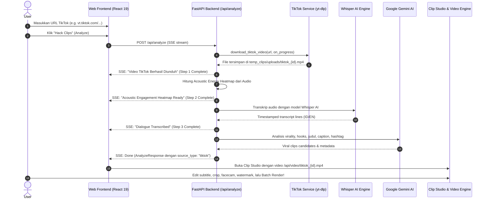

# Implementation Plan: Dukungan URL TikTok pada Cheat Clip PRO

Dokumen ini menjelaskan rancangan arsitektur dan langkah implementasi teknis untuk menambahkan dukungan pemrosesan URL video TikTok ke dalam **Cheat Clip PRO**, disesuaikan secara penuh dengan seluruh fitur unggulan aplikasi yang sudah ada.

---

## 🎯 Goal Description

Cheat Clip PRO saat ini mendukung input video dari **YouTube** (URL), **Google Drive** (share link), dan **File Upload** (file lokal). 
Tujuan dari perubahan ini adalah menambahkan **TikTok** sebagai sumber input resmi ke-4. Pengguna dapat menempelkan tautan video TikTok (baik format desktop, mobile `m.tiktok.com`, maupun shortlink `vt.tiktok.com`, `vm.tiktok.com`, atau `tiktok.com/t/`), lalu:
1. Video diunduh dengan resolusi terbaik tanpa watermark (menggunakan engine `yt-dlp` yang sudah terpasang).
2. Video disimpan ke direktori lokal cache (`backend/temp_clips/uploads/tiktok_{id}_*.mp4`) agar cepat dan hemat bandwidth saat diakses ulang.
3. Audio diekstrak untuk menghasilkan kurva **acoustic energy heatmap** (deteksi momen paling dinamis/berenergi tinggi).
4. Audio diproses oleh **OpenAI Whisper AI** untuk menghasilkan transkrip percakapan berstempel waktu (timestamped transcript) dengan deteksi bahasa otomatis (Indonesia / Inggris).
5. Transkrip dan data engagement audio dianalisis oleh **Google Gemini AI** untuk memotong klip-klip viral secara otomatis (hooks, virality score 1-100, quotes, rekomendasi judul & caption sosial media, dan hashtag).
6. Klip langsung dapat dipratinjau dan dikustomisasi di **Clip Studio**:
   - Pemutar video HTML5 lokal langsung (`/api/video/...`) tanpa gangguan iframe pihak ketiga.
   - Deteksi & pelacakan wajah otomatis (**Face Tracking / Face Centering**) menggunakan OpenCV.
   - Pilihan rasio aspek: mempertahankan 9:16 vertikal asli TikTok atau mengubah ke 1:1, 4:3, atau 16:9.
   - Subtitle animasi karaoke (*Viral Pop*, *Beast Punch*, *Cyber Violet*, dll.).
   - Watermark kustom, background music (BGM), hook sound effects (SFX), dan voice boost.
   - Pemotongan manual interaktif di **Clip Trimmer Modal**.
   - Rendering lokal berakselerasi hardware (NVENC, AMF, QSV, CPU) atau WebAssembly, dengan ekspor single/batch zip atau raw MP4.
7. Disimpan ke riwayat (**History**) dengan badge khusus TikTok dan kemampuan pemulihan status satu klik.
8. Tersedia penuh dalam dwibahasa: **Bahasa Indonesia** dan **English**.

---

## 🔍 User Review Required

> [!IMPORTANT]
> **Karakteristik Video TikTok vs YouTube**:
> - Video TikTok mayoritas sudah berformat vertikal 9:16 (tinggi > lebar), berbeda dengan video YouTube yang mayoritas 16:9 horizontal.
> - Di **Clip Studio**, jika rasio aspek dipilih `9:16` pada video yang aslinya sudah `9:16`, sistem akan mempertahankan framing asli tanpa *double-crop* atau pemotongan sisi berlebih. Fitur *Face Tracking* tetap dapat diaktifkan untuk menjaga pembicara tetap berada di tengah jika terjadi pergeseran kamera.
> - TikTok tidak menyediakan kurva retensi pemirsa detik-per-detik publik seperti YouTube. Oleh karena itu, sama seperti Google Drive dan File Upload, aplikasi akan menggunakan analisis **Acoustic Energy Heatmap** dari spektrum audio untuk mendeteksi puncak antusiasme & intonasi pembicara.

> [!NOTE]
> **Dukungan Format URL TikTok**:
> Sistem akan mengenali semua format tautan TikTok:
> - Format Web Standar: `https://www.tiktok.com/@username/video/1234567890123456789`
> - Format Web dengan Query Params: `https://www.tiktok.com/@user/video/123?is_from_webapp=1&sender_device=pc`
> - Format Shortlink Mobile: `https://vt.tiktok.com/ZSxxxxxx/` dan `https://vm.tiktok.com/ZMxxxxxx/`
> - Format Global Shortlink: `https://www.tiktok.com/t/ZTxxxxxx/`
> - Format Mobile Web: `https://m.tiktok.com/v/1234567890123456789.html`

---

## ❓ Open Questions

> [!TIP]
> Saat ini `yt-dlp` yang terpasang di komputer Anda (`v2026.10.21`) sudah memiliki built-in extractor `TikTokIE` dan `TikTokVMIE` yang dapat mengunduh video TikTok publik secara langsung tanpa login. 
> 
> Apakah Anda ingin menambahkan input opsional untuk **TikTok Session Cookies** pada modal cookies jika sewaktu-waktu TikTok menerapkan pembatasan IP (seperti bot verification), atau cukup memanfaatkan pipeline `yt-dlp` bawaan yang saat ini sudah sangat andal?
> *(Secara default, kami merancang agar pengguna langsung menempelkan URL tanpa perlu repot mengatur cookies, namun jika cookies ada di browser, tetap diteruskan secara otomatis).*

---

## 🏗️ Architecture & Data Flow



---

## 📦 Proposed Changes

### Component 1: Backend Services & Engine

#### [NEW] `backend/services/tiktok_service.py`
Layanan baru khusus untuk menangani validasi URL, ekstraksi ID, pengecekan cache, dan pengunduhan video TikTok menggunakan `yt-dlp`.

```python
# backend/services/tiktok_service.py
import logging
import os
import re
import time
from pathlib import Path
from typing import Callable, Optional

import yt_dlp

from backend.config import TEMP_DIR, UPLOADS_DIR, get_effective_cookies_path, logger

TIKTOK_URL_REGEX = re.compile(
    r'(?:https?://)?(?:www\.|vt\.|vm\.|m\.)?tiktok\.com/(?:t/|@[\w\.-]+/video/|v/|[\w-]+/video/|[\w-]+)?',
    re.IGNORECASE
)

def is_tiktok_url(url: str) -> bool:
    """Mengecek apakah URL yang diberikan adalah tautan video TikTok yang valid."""
    if not url:
        return False
    u = url.strip()
    return bool(
        re.search(r'tiktok\.com', u, re.IGNORECASE) or 
        re.search(r'vt\.tiktok\.com', u, re.IGNORECASE) or 
        re.search(r'vm\.tiktok\.com', u, re.IGNORECASE)
    )

def extract_tiktok_id(url: str) -> Optional[str]:
    """Mengekstrak ID numerik atau identifier unik dari tautan TikTok."""
    if not url:
        return None
    u = url.strip()
    # 1. Match numeric video ID: /video/(\d+) atau /v/(\d+)
    m = re.search(r'/(?:video|v)/(\d+)', u)
    if m:
        return m.group(1)
    # 2. Match shortcode: vt.tiktok.com/(\w+) atau vm.tiktok.com/(\w+) atau tiktok.com/t/(\w+)
    m_short = re.search(r'(?:vt|vm)\.tiktok\.com/([\w-]+)', u)
    if m_short:
        return m_short.group(1)
    m_t = re.search(r'tiktok\.com/t/([\w-]+)', u)
    if m_t:
        return m_t.group(1)
    return None

def download_tiktok_video(
    url: str,
    on_progress: Optional[Callable[[str, str, int], None]] = None,
    cookies_content: Optional[str] = None
) -> Path:
    """
    Mengunduh video TikTok ke UPLOADS_DIR.
    1. Memeriksa cache lokal jika ID video sudah pernah diunduh.
    2. Menjalankan yt-dlp dengan progress hooks real-time.
    3. Menggabungkan video + audio menjadi container MP4 yang kompatibel dengan browser & ffmpeg.
    Mengembalikan objek Path ke file video lokal.
    """
    # Implementasi lengkap dengan caching, progress reporting, dan exception handling
```

---

#### [MODIFY] `backend/routers/analyze.py`
Menambahkan integrasi `is_tiktok_url` dan `download_tiktok_video` pada alur analisis Server-Sent Events (SSE):

```diff
--- a/backend/routers/analyze.py
+++ b/backend/routers/analyze.py
@@ -35,6 +35,7 @@
 from backend.services.gdrive_service import (
     download_google_drive_video,
     is_google_drive_url,
 )
+from backend.services.tiktok_service import (
+    download_tiktok_video,
+    is_tiktok_url,
+)
...
@@ -239,7 +240,46 @@
         is_gdrive = is_google_drive_url(req_clean)
+        is_tiktok = is_tiktok_url(req_clean)
         uploaded_file_path: Optional[Path] = None
 
-        if is_gdrive:
+        if is_tiktok:
+            yield _sse({
+                "step": 1,
+                "step_progress": 10,
+                "overall_progress": 5,
+                "stage": "Connecting to TikTok",
+                "detail": "Resolving TikTok media stream & preparing download...",
+                "message": "Connecting to TikTok..."
+            })
+            loop = asyncio.get_running_loop()
+            tt_queue: asyncio.Queue = asyncio.Queue()
+
+            def tt_progress(stage: str, detail: str, step_pct: int = 30):
+                loop.call_soon_threadsafe(tt_queue.put_nowait, {
+                    "step": 1,
+                    "step_progress": step_pct,
+                    "overall_progress": min(22, 5 + int(step_pct * 0.17)),
+                    "stage": stage,
+                    "detail": detail,
+                    "message": detail
+                })
+
+            try:
+                task = asyncio.create_task(
+                    asyncio.to_thread(download_tiktok_video, req_clean, tt_progress, request.cookies)
+                )
+                while not task.done():
+                    try:
+                        evt = await asyncio.wait_for(tt_queue.get(), timeout=0.2)
+                        yield _sse(evt)
+                    except asyncio.TimeoutError:
+                        pass
+                while not tt_queue.empty():
+                    yield _sse(tt_queue.get_nowait())
+
+                uploaded_file_path = await task
+                is_uploaded = True
+            except Exception as e:
+                yield _sse({"error": f"Failed to fetch video from TikTok: {str(e)}", "status": 400})
+                return
+        elif is_gdrive:
...
@@ -310,7 +350,7 @@
-            canonical_url = req_clean if is_gdrive else f"/api/video/{uploaded_file_path.name}"
+            canonical_url = req_clean if (is_gdrive or is_tiktok) else f"/api/video/{uploaded_file_path.name}"
             video_url = f"/api/video/{uploaded_file_path.name}"
-            source_type = "gdrive" if is_gdrive else "upload"
+            source_type = "tiktok" if is_tiktok else ("gdrive" if is_gdrive else "upload")
```

---

#### [MODIFY] `backend/video_engine.py`
Memastikan pemotongan klip (slicing), perenderan frame, dan face tracking mengenali awalan `tiktok_`:

```diff
--- a/backend/video_engine.py
+++ b/backend/video_engine.py
@@ -792,7 +792,7 @@
-            match_id = re.search(r'(gdrive_[a-zA-Z0-9_-]+|upload_[a-zA-Z0-9_-]+)', clean_raw)
+            match_id = re.search(r'(gdrive_[a-zA-Z0-9_-]+|upload_[a-zA-Z0-9_-]+|tiktok_[a-zA-Z0-9_-]+)', clean_raw)
             if match_id:
-                raw_id = match_id.group(1).replace("gdrive_", "").replace("upload_", "")
+                raw_id = match_id.group(1).replace("gdrive_", "").replace("upload_", "").replace("tiktok_", "")
...
@@ -804,7 +804,7 @@
-        is_direct_upload = "upload_" in clean_raw.lower() or "gdrive_" in clean_raw.lower()
+        is_direct_upload = "upload_" in clean_raw.lower() or "gdrive_" in clean_raw.lower() or "tiktok_" in clean_raw.lower()
...
@@ -843,7 +843,7 @@
-    if "gdrive" in clean_raw.lower() or "upload_" in clean_raw.lower() or clean_raw.startswith("/api/video/"):
+    if "gdrive" in clean_raw.lower() or "upload_" in clean_raw.lower() or "tiktok_" in clean_raw.lower() or clean_raw.startswith("/api/video/"):
         raise RuntimeError(f"Source video file not found on disk for '{clean_raw}'. Please re-analyze the video.")
```

---

#### [MODIFY] `backend/services/render_service.py`, `backend/services/download_service.py`, & `backend/routers/downloads.py`
Mendukung `tiktok_` pada `request.video_id` saat batch render atau download raw clip:

```python
# Menambahkan pemeriksaan tiktok_ pada penentuan target_url
if request.video_id and (
    request.video_id.startswith("gdrive_") or 
    request.video_id.startswith("upload_") or 
    request.video_id.startswith("tiktok_")
):
    if not target_url.startswith("/api/video/"):
        target_url = f"/api/video/{request.video_id}"
```

---

### Component 2: Frontend Types & Locales

#### [MODIFY] `src/types.ts`
Menambahkan tipe `'tiktok'` pada `source_type`:

```diff
--- a/src/types.ts
+++ b/src/types.ts
@@ -37,7 +37,7 @@ export interface AnalyzeResponse {
   model?: string;
   video_url?: string;
-  source_type?: 'youtube' | 'upload' | 'gdrive';
+  source_type?: 'youtube' | 'upload' | 'gdrive' | 'tiktok';
 }
```

---

#### [MODIFY] `src/locales/en.ts` & `src/locales/id.ts`
Menambahkan terjemahan antarmuka untuk tab TikTok:

**`src/locales/en.ts`**:
```typescript
    tabTiktok: "TikTok Video",
    tiktokUrlLabel: "TikTok Video URL",
    tiktokUrlPlaceholder: "Paste TikTok video link (e.g. https://www.tiktok.com/@... or vt.tiktok.com/...)",
    tiktokNotice: "TikTok video will be downloaded, transcribed with Whisper AI, and analyzed for viral moments.",
    tiktokBadge: "TikTok",
```

**`src/locales/id.ts`**:
```typescript
    tabTiktok: "Video TikTok",
    tiktokUrlLabel: "URL Video TikTok",
    tiktokUrlPlaceholder: "Tempel tautan video TikTok (misal: https://www.tiktok.com/@... atau vt.tiktok.com/...)",
    tiktokNotice: "Video TikTok akan diunduh, ditranskrip secara otomatis menggunakan Whisper AI, dan dianalisis untuk klip viral.",
    tiktokBadge: "TikTok",
```

---

### Component 3: Frontend Interface & Player Integration

#### [MODIFY] `src/App.tsx`
1. Memperluas state `sourceMode`:
   ```typescript
   const [sourceMode, setSourceMode] = useState<'youtube' | 'gdrive' | 'upload' | 'tiktok'>('youtube');
   const [tiktokUrl, setTiktokUrl] = useState('');
   ```
2. Menambahkan tombol Tab **TikTok Video** di antara Google Drive dan Upload:
   - Diberi ikon SVG resmi TikTok.
   - Efek neon gradien bertema TikTok (cyan `#00f2fe` dan aksen pink `#fe2c55`).
3. Menambahkan kontainer input form TikTok dengan validasi URL, tombol *"Hack Clips"*, dan info petunjuk.
4. Menangani submit form untuk TikTok pada `handleSubmit`:
   - Validasi URL TikTok menggunakan regex regex `isTikTokUrl(tiktokUrl)`.
   - Mengirim request ke `/api/analyze` dengan streaming SSE progress.
5. Menampilkan badge riwayat bertema TikTok dan pemulihan URL saat entri riwayat diklik.

---

#### [MODIFY] `src/components/ClipStudioSection.tsx` & `src/components/ClipTrimmerModal.tsx`
1. Memastikan pemutar HTML5 langsung digunakan untuk TikTok (`videoId.startsWith('tiktok_')` atau `sourceType === 'tiktok'`):
   ```typescript
   const isYouTube = !videoId?.startsWith('upload_') && 
                     !videoId?.startsWith('gdrive_') && 
                     !videoId?.startsWith('tiktok_') && 
                     !videoUrl?.includes('/api/video');
   ```
2. Pada `ClipTrimmerModal.tsx`:
   ```typescript
   const isDirectVideo = Boolean(
     sourceType === 'gdrive' ||
     sourceType === 'upload' ||
     sourceType === 'tiktok' ||
     videoId?.startsWith('gdrive_') ||
     videoId?.startsWith('upload_') ||
     videoId?.startsWith('tiktok_') ||
     videoUrl?.startsWith('/api/video/') ||
     videoUrl?.startsWith('blob:')
   );
   ```
3. Memastikan pemangkasan, pelacakan wajah, dan perenderan klip berjalan mulus dengan file MP4 lokal.

---

## 🧪 Verification Plan

### Automated Tests
1. **TypeScript Build Verification**:
   ```bash
   npx tsc -b
   ```
2. **Backend Syntax & Module Import Check**:
   ```bash
   python -c "from backend.services.tiktok_service import is_tiktok_url, extract_tiktok_id; print('TikTok service imports successfully!')"
   ```
3. **Unit Test Helper Functions**:
   Memvalidasi fungsi regex parsing URL untuk berbagai varian format tautan TikTok:
   ```bash
   python -c "from backend.services.tiktok_service import is_tiktok_url, extract_tiktok_id; assert is_tiktok_url('https://www.tiktok.com/@user/video/7123456789012345678'); assert is_tiktok_url('https://vt.tiktok.com/ZSxxxxxx/'); assert is_tiktok_url('https://vm.tiktok.com/ZMxxxxxx/'); print('All URL tests passed!')"
   ```

### Manual Verification
1. **Uji Antarmuka (UI)**:
   - Jalankan `npm run dev` dan buka `http://localhost:5173`.
   - Periksa keberadaan tab ke-4 **Video TikTok** dengan desain ikon dan warna yang presisi.
   - Ganti bahasa ke Bahasa Indonesia dan English, pastikan label dan placeholder berganti secara tepat.
2. **Uji Analisis Video TikTok**:
   - Tempelkan URL video TikTok publik (format biasa atau `vt.tiktok.com`).
   - Masukkan Gemini API Key atau ketik `mock`.
   - Klik **"Hack Clips"** dan perhatikan alur Server-Sent Events (SSE):
     * *Connecting to TikTok* -> *Downloading Video* -> *Computing Acoustic Heatmap* -> *Transcribing with Whisper* -> *Generating Viral Clips*.
3. **Uji Clip Studio & Player**:
   - Pastikan video TikTok langsung diputar di pemutar video lokal HTML5 tanpa lag atau error iframe.
   - Buka **Clip Trimmer Modal**, geser timeline pemotong dan pastikan video merespons secara instan.
   - Pilih preset subtitle dan lakukan uji coba render 1 klip atau batch render.
4. **Uji Riwayat (History)**:
   - Muat ulang halaman, periksa apakah video TikTok muncul di kartu riwayat dengan badge TikTok.
   - Klik riwayat tersebut dan pastikan klip-klip beserta videonya kembali dimuat secara instan dari cache lokal.
